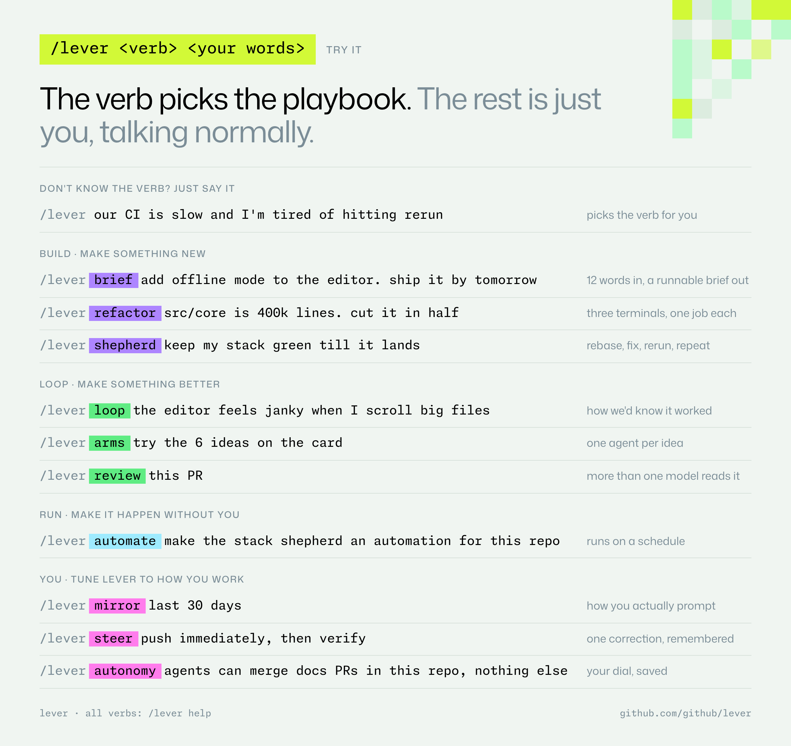
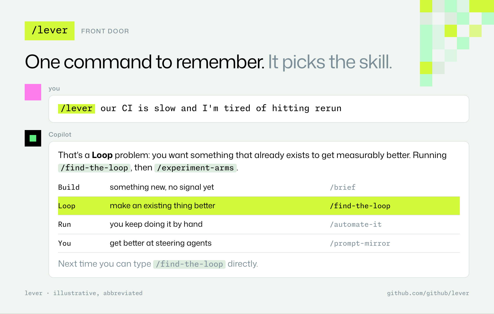
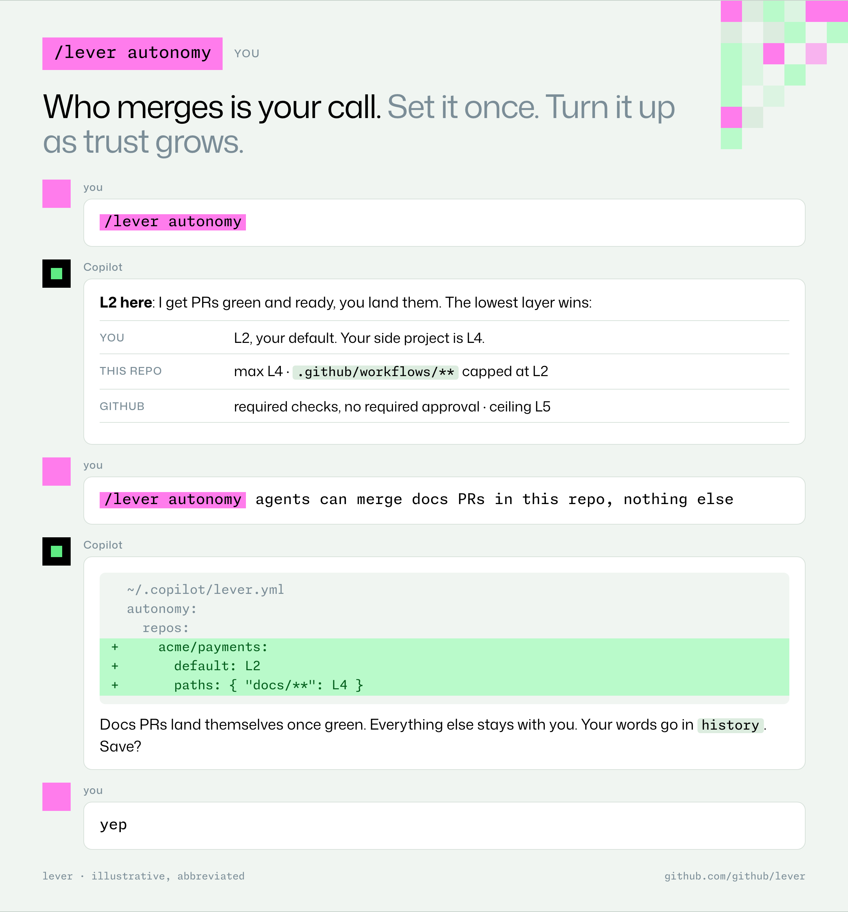

# lever

**Copilot skills for building feedback loops, delegating safely, and moving repeatable work into the cloud.**

> The loop is the product. The agent is the motor.

lever is a set of [agent skills](https://docs.github.com/copilot) for GitHub Copilot: the CLI, the app, and the coding agent. They weren't designed on a whiteboard. They were **mined from about a year of real sessions**: ~9.5k hand-typed prompts across ~1.8k sessions, plus CI speedups, unattended delivery, and Copilot Automations that ran in production. Each skill exists because the same lesson came up over and over in that data.

The lesson behind most of them: the biggest wins came from **building a trustworthy feedback loop first** and then letting agents iterate against it. The biggest wastes came when the human *was* the loop: pasting screenshots, eyeballing frame rates, watching CI overnight, hand-editing an automation's prompt.

## Where it came from

lever grew out of the [autonomous-delivery skill](https://gist.github.com/EvanBoyle/8c1a97f682d92dab8c09d0e1ea73f4a0): a coordinator that keeps parallel work moving, lands it and keeps improving how it's organized. Running that skill for weeks showed which parts really carried the weight. Those parts are now the separate skills here: the loop, the brief, the dial, the status contract, the review, and moving lanes into the cloud. [`autonomous-delivery`](skills/autonomous-delivery/) is still the top-level orchestrator that ties them together.

## Pick a mode first

Not everything is a loop. lever works in three [modes](docs/modes.md), and most projects move through all three:

| Mode | When | Start with |
|---|---|---|
| **Build** | Something big and new, with no signal to climb yet. File issues, run independent sessions in parallel, merge, deploy, repeat. | `/lever brief` → `/lever deliver` |
| **Loop** | Make an existing thing measurably better. | `/lever loop` → `/lever arms` |
| **Run** | Repeatable work that should happen without you. | `/lever automate` |

Two dials apply to every mode: **[autonomy](docs/autonomy.md)** (how much agents may do on their own) and **[spend](docs/spend.md)** (how many tokens and how much compute you'll pay for: `lean`, `standard` or `max`).

## Lower the floor, raise the ceiling

| Question | Floor: anyone, day one | Ceiling: unattended, at scale |
|---|---|---|
| **The task**: is this change actually better? | [`find-the-loop`](skills/find-the-loop/) | [`experiment-arms`](skills/experiment-arms/) |
| **The work**: is delivery moving, landing, visible? | [`brief`](skills/brief/) · [`progress-contract`](skills/progress-contract/) | [`autonomous-delivery`](skills/autonomous-delivery/) · [`pr-shepherd`](skills/pr-shepherd/) · [`landing-plan`](skills/landing-plan/) · [`cross-model-review`](skills/cross-model-review/) · [`refactor-pipeline`](skills/refactor-pipeline/) |
| **You**: are you getting better at directing agents? | [`prompt-mirror`](skills/prompt-mirror/) | [`steer-once`](skills/steer-once/) |
| **The repo, in the cloud**: does repeatable work happen without you, and improve itself? | [`automate-it`](skills/automate-it/) | [`automations/`](automations/) · [`keep-the-pool-full`](skills/keep-the-pool-full/) · [`run-health-review`](skills/run-health-review/) |

Shared by every skill:
- **[Autonomy dial](docs/autonomy.md)** (L0 propose → L5 land, release, observe). How much an agent may do on its own is *your setting*, saved in `~/.copilot/lever.yml` and tuned with `/lever autonomy` as your trust grows. It's capped by your repo's own rules and never hard-coded.
- **[Spend dial](docs/spend.md)** (`lean` · `standard` · `max`): model tier, parallel lanes, review depth and trigger cadence, with order-of-magnitude costs.
- **[Loop Card](templates/loop-card.md)**: outcome, metric, instrument, noise floor, keep bar, stop rule.
- **[Ledger](templates/ledger.md)**: every attempt is recorded, including rejects.
- **[Status digest](templates/status-digest.md)**: `x → y (Δ%)`, ETA, evidence level, silent when nothing changed.

## Start here

One command: **`/lever`**. Give it a verb, or just say what's wrong and it picks the verb, tells you which, and runs it.

1. **Stuck, or iterating by feel?** `/lever loop`. It turns "it still feels slow" into a metric the agent can measure itself.
2. **Handing off work?** `/lever brief`. It turns your 20-word ask into something an agent can run unattended, with a done-when, a budget, and an autonomy level.
3. **Doing the same thing for the third time?** `/lever automate`. It turns it into a Copilot Automation that starts paused, uses least-privilege tools, and comes with an improver that proposes fixes for you to approve.
4. **Want lever to fit *you*?** `/lever setup` sets your dials. `/lever mirror` reads your own session history, and `/lever steer` turns your repeated corrections into rules that stick.

## Commands

```text
/lever <what's bugging you>      not sure? describe it. lever picks the verb.

BUILD   make something new
  brief <ask>                    turn ~20 words into a brief an agent can run unattended
  deliver [brief|issues]         run lanes in parallel and land the work
  refactor <scope> <goal>        huge mechanical change: producer, packager, shepherd
  backlog                        keep enough ready issues in the pool
  shepherd [pr|stack]            keep PRs green until they land
  land [prs]                     merge plan for a stack or a batch
  status                         progress you never have to ask for

LOOP    make something measurably better
  loop <problem>                 find the feedback loop first: a Loop Card
  arms [ideas]                   one agent per idea, against a control
  review [pr|plan]               several models, blind; only agreed findings

RUN     make it happen without you
  automate <task>                turn a chore into a paused Copilot Automation
  health                         why did it stall? one fix, or "no change"

YOU     tune lever to how you work
  mirror [30d]                   a scorecard of how you prompt, from your sessions
  steer <correction>             say it once, never again
  autonomy [L0-L5|<words>]       who merges. see or set your dial
  spend [lean|standard|max]      how much model to throw at it
  setup                          first run: set your dials
  help [verb]                    this list, or one verb in detail
```

Each verb is a skill in [`skills/`](skills/). The `/` menu shows only `/lever`. The rest stay out of the way, and Copilot still loads them on its own when your ask fits.

## Try it



<details><summary>Copy-pasteable</summary>

```text
/lever our CI is slow and I'm tired of hitting rerun
/lever loop the editor feels janky when I scroll big files
/lever arms try the 6 ideas on the card
/lever brief add offline mode to the editor. ship it by tomorrow
/lever refactor src/core is 400k lines. cut it in half
/lever shepherd keep my stack green till it lands
/lever review this PR
/lever automate make the stack shepherd an automation for this repo
/lever mirror last 30 days
/lever steer push immediately, then verify
/lever autonomy agents can merge docs PRs in this repo, nothing else
```

</details>





More in the **[examples gallery](docs/examples.md)**: a Loop Card, experiment arms, a brief, the three-terminal refactor, the PR shepherd, cross-model review, an automation and the "You" verbs.

## Install

```bash
# All skills, for your user (Copilot CLI / app)
git clone https://github.com/github/lever ~/.copilot/lever
ln -s ~/.copilot/lever/skills/* ~/.copilot/skills/

# Or per repo
mkdir -p .github/skills && cp -r path/to/lever/skills/find-the-loop .github/skills/
```

Then run `/lever setup`. It asks three questions and writes your dials to `~/.copilot/lever.yml` ([example](config/personal.example.yml)). For a team, copy [`config/autonomy.example.yml`](config/autonomy.example.yml) to `.github/lever.yml` to cap levels and set budgets for the repo.

Automation recipes in [`automations/`](automations/) are installed through the GitHub MCP server (`create_automation`). Each one is created paused, dry-run on historical items, then enabled.

## Make it yours

lever is a starting point, not a doctrine. The skills hold the patterns that kept repeating in one person's data. Yours will differ. `prompt-mirror` and `steer-once` exist so you can mine your own sessions, find your own repeated corrections, and fold them back in. Fork it and tune it.

## What the data said (a few numbers)

- **Experiment arms:** 79 do-not-merge experiment PRs led to 27 kept changes. CI p50 time-to-green fell 43% (p90 −45%) in about a day and a half. Ideas that lost were kept as `[negative result]` PRs.
- **Corrections that stick:** agents replied "You're right" 75 times and kept making the same mistakes. Turning ~200 of those corrections into a skill cut repeat nudges from 27 to 0 and invented-approval language from 31% to 3%.
- **Loops replace eyeballs:** pasted screenshots fell from ~49 a month to ~0 once agents could run the instrument themselves.
- **Automations:** one morning-status prompt was typed by hand 28 days in a row before it became an automation. Review automations had 46–49 tools; about 8 were needed.
- **The human's share:** in unattended weeks, the human typed roughly 3–5% of turns. The job moved to setting direction, budgets and autonomy.

## What's possible

Rough ranges from the data behind these skills, so you can calibrate what to aim for. These are orders of magnitude, not benchmarks.

| Dimension | Pairing with an agent | With these loops in place |
|---|---|---|
| Unattended run length | minutes to hours | **days to weeks** |
| Sessions one coordinator steers | 1–5 | **10s to 100s** |
| Share of turns a human types | most | **low single-digit %** |
| Automated review runs per day | 10s | **1,000s**, most correctly posting nothing |
| Inline review findings per run | — | **under 1 in 10** runs (precision over recall) |
| PR size when running unattended | 100s–1,000s of lines | **~5–10× smaller** |
| Time to merge as volume rises | grows | **roughly halves** |
| Cost of a per-push trigger with no draft filter | — | **~2–3× runs per PR** |
| Cost of a premium model tier | 1× | **~10–15× per call**; make it a visible dial |
| CI time-to-green from experiment arms | — | **−30% to −45%** at p50, in **1–2 days** |

The human's job shifts from writing code to **filling the queue, setting budgets and diagnosing stalls**. None of that needs a special system. It needs the loops in this repo, a dial you trust, and automations that improve themselves under your approval.

## Status

Draft. Feedback welcome via issues.
