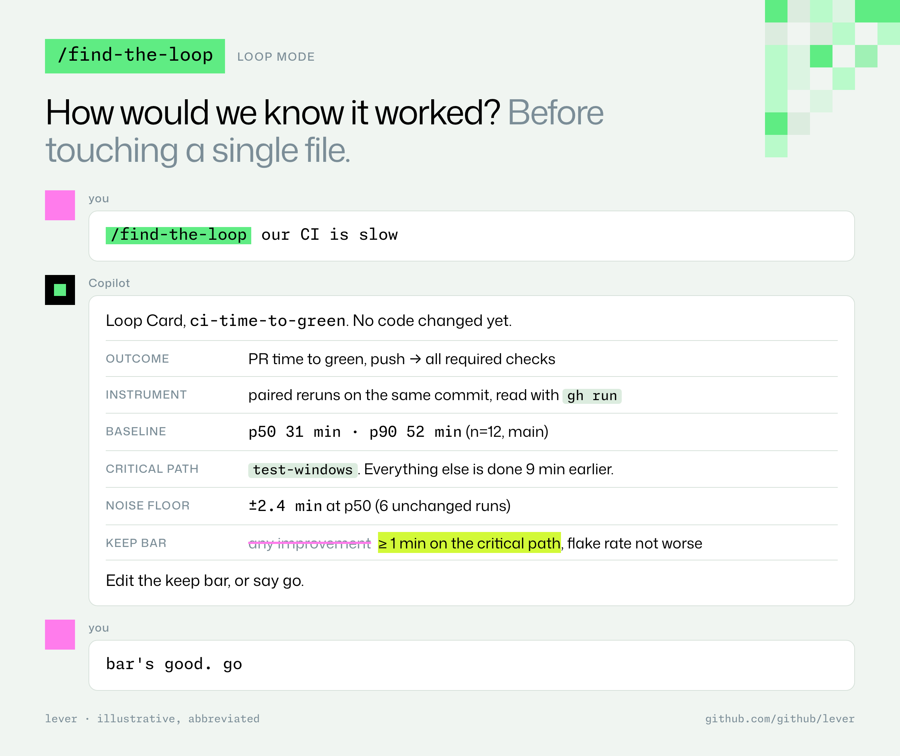
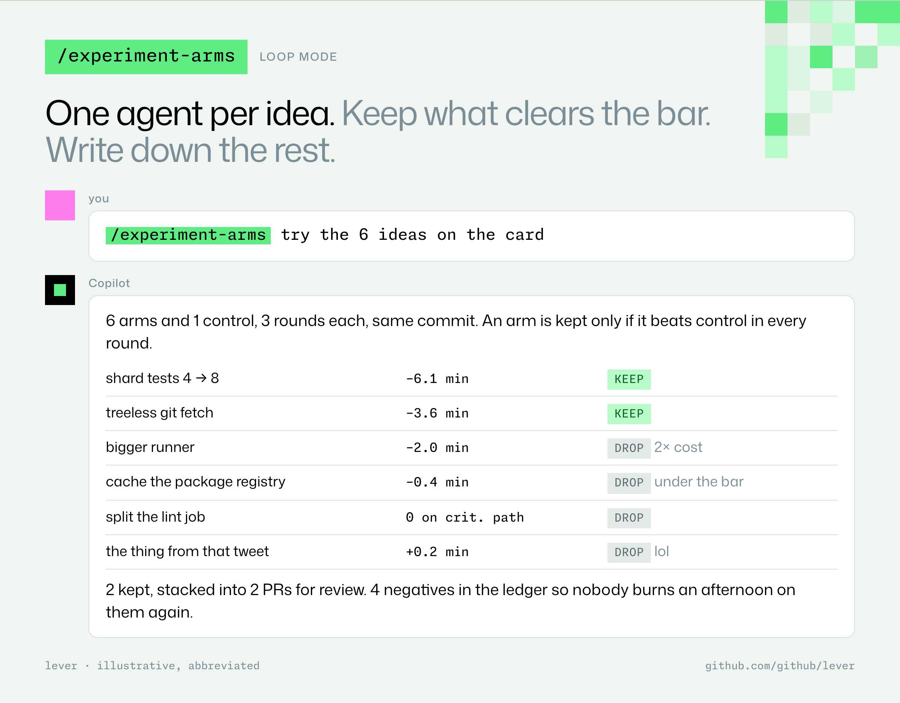
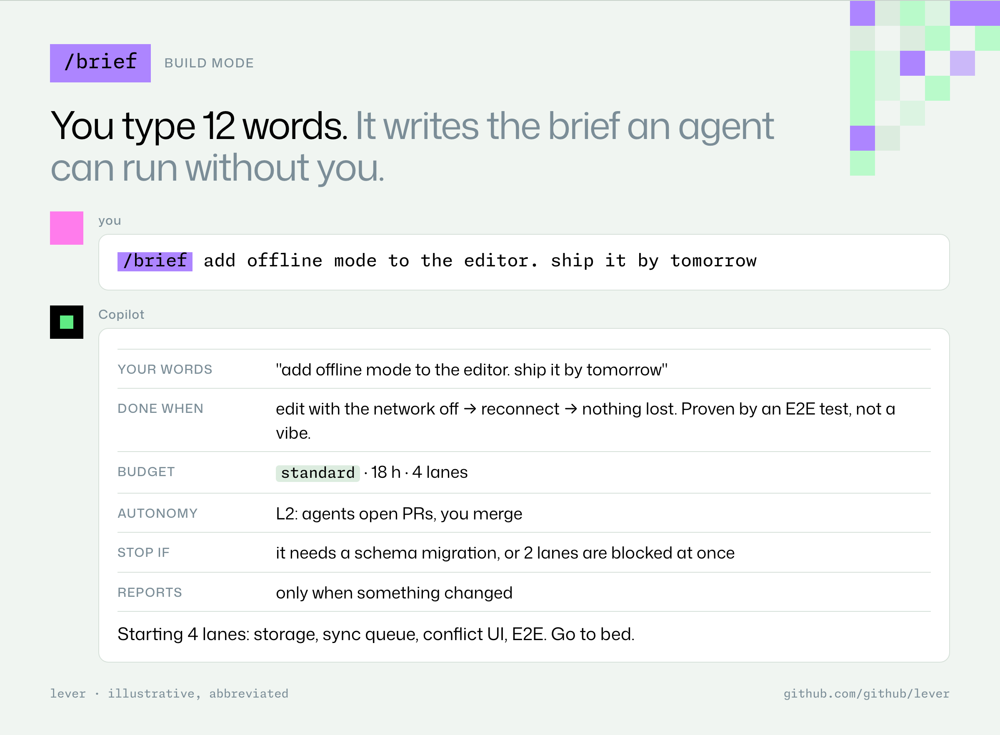
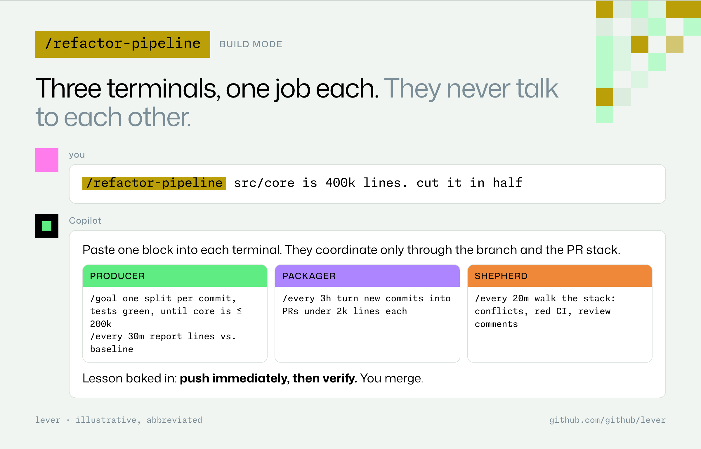
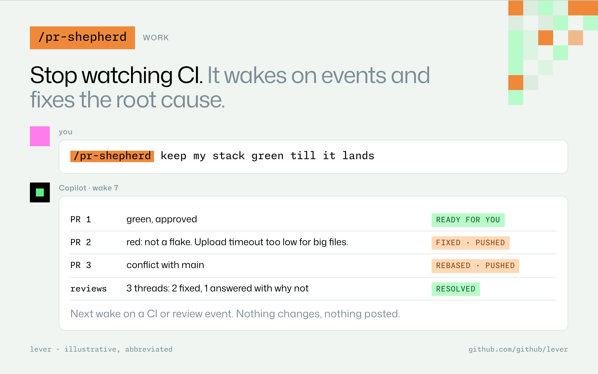
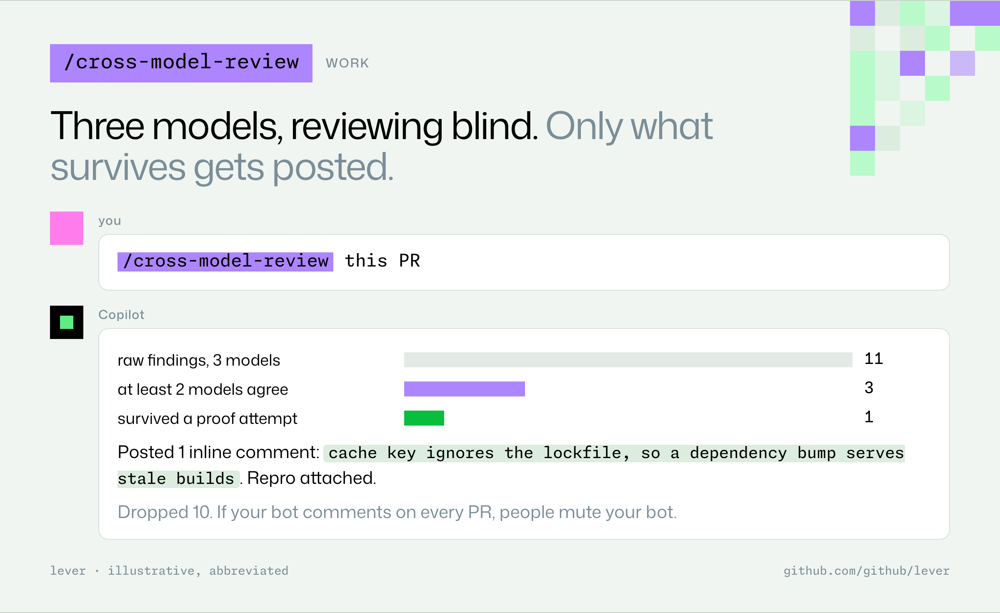
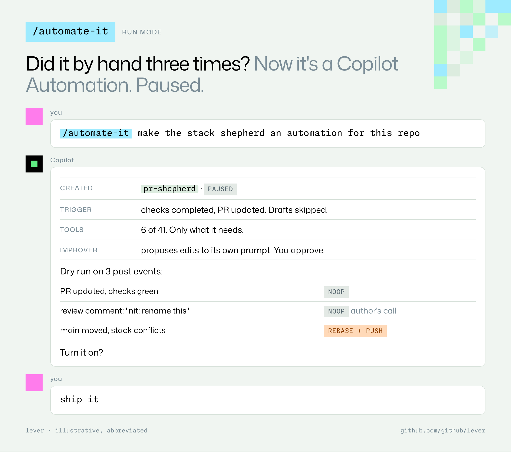
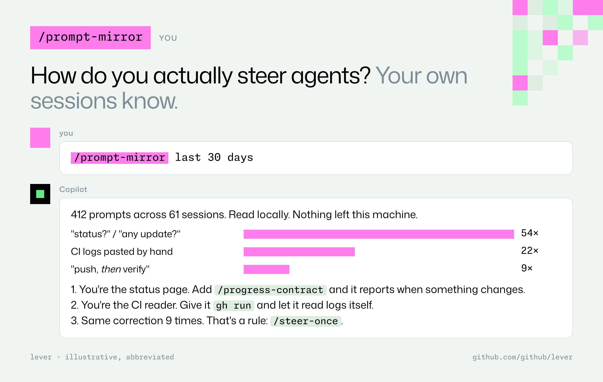
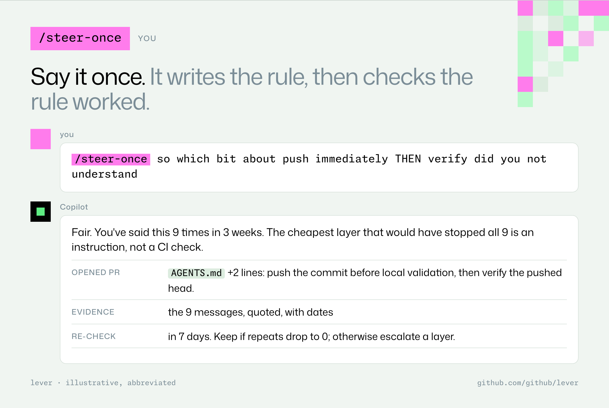

# Examples

Illustrative exchanges, abbreviated. The numbers are made up; the shapes are real. Each card is one command and roughly what comes back.

Invoke any skill as `/<skill> <your ask>`. If you don't know which one, use `/lever <your ask>`.

## Front door


## Loop: make an existing thing measurably better





## Build: something new, no signal yet





## Getting work landed





## Run: work that should happen without you



## You: get better at steering agents





---

The cards are rendered from [`examples/examples.html`](examples/examples.html). To change one, edit the HTML and run:

```bash
NODE_PATH=/path/to/node_modules node docs/examples/render.mjs   # needs playwright, @fontsource/mona-sans, @fontsource/monaspace-neon
```
